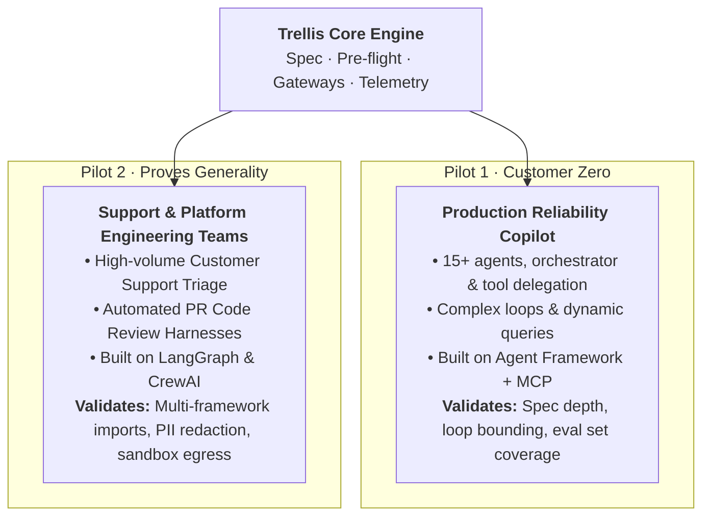

# Trellis: Engineering Implementation Plan & Roadmap

This document outlines the implementation roadmap, pilot strategies, architectural decisions, risk assessments, and success metrics for **Trellis**, a vendor-neutral workbench and control plane for enterprise agentic systems.

---

## 1. Five-Phase Engineering Roadmap

Durations assume a dedicated engineering squad of **3–4 engineers**. Every phase delivers direct production value to engineering teams and ends with an objectively verified **exit test**.

```mermaid
gantt
    title Trellis 5-Phase Implementation Timeline
    dateFormat  X
    axisFormat  Wk %s

    section Phase 0
    Spec, Schema & Importers :active, p0, 0, 3

    section Phase 1
    Pre-Flight Engine (CLI & CI) :p1, 3, 9

    section Phase 2
    Gateways, Policy & OTel Telemetry :p2, 9, 17

    section Phase 3
    Studio Canvas & Durable Runtime :p3, 17, 27

    section Phase 4
    Closed-Loop Learning & Skill Registry :p4, 27, 34
```

---

### Phase 0: Graph Specification, Schema & Framework Importers
*Duration: Weeks 1–3*

#### Objectives
1. Formulate the declarative **Graph Spec v1alpha1** and publish its formal **JSON Schema**.
2. Build bidirectional AST importers for existing frameworks (starting with **Microsoft Agent Framework** and **LangGraph**).
3. Implement automated connector contract generators that derive typed node schemas from **Model Context Protocol (MCP)** tool annotations and **OpenAPI v3** definitions.
4. Provide a static visualization and DAG validation utility.

#### Key Deliverables
- `@trellis/spec`: Schema validator and serialization utilities.
- `@trellis/importer-agent-framework`: Parses agent code into `AgentSystem` YAML.
- `@trellis/importer-langgraph`: Converts LangGraph `StateGraph` definitions to spec nodes and edges.
- `@trellis/mcp-contract-gen`: CLI utility inspecting running MCP servers to generate connector contracts.

> **Exit Test:**
> A complex production multi-agent system (including orchestrator, subsidiary agents, and tool-delegation edges) imports and renders as a complete Trellis graph with zero manual specification edits.

---

### Phase 1: Pre-Flight Engine as CLI & CI/CD Gate
*Duration: Weeks 4–9*

#### Objectives
1. Implement the core **10-rule static lint engine** targeting topology, security boundaries, and reliability hazards.
2. Develop the **Monte Carlo cost and latency forecaster** that runs dynamic path sampling across branches, loops, and token distributions.
3. Establish a deterministic **0–100 graph quality rating** and pass/fail gate configuration.
4. Package the engine as a standalone CLI (`trellis preflight`) and native CI/CD actions for **GitHub Actions** and **Azure DevOps Pipelines**.

#### Key Deliverables
- `@trellis/preflight-core`: Rule engine, DAG visitor, Monte Carlo simulator (2,000 passes/sec).
- `@trellis/cli`: Cross-platform CLI binary.
- GitHub Action: `trellis/preflight-action@v1` with PR diff commenting and status check reporting.
- Azure DevOps Task: `TrellisPreflightGate@1`.

> **Exit Test:**
> Two distinct pilot engineering teams integrate `trellis preflight` into their CI pipelines and identify/remediate at least **5 genuine configuration, security, or cost issues** before code merges to staging.

---

### Phase 2: Security Gateways, Policy as Code & Observability
*Duration: Weeks 10–17*

#### Objectives
1. Deploy the unified **Model Gateway** for rate limiting, token quota enforcement, semantic caching, and automatic PII redaction.
2. Deploy the **Tool & MCP Gateway** acting as an authenticating reverse proxy for all agent-initiated tool calls with risk-tier approval workflows.
3. Deploy the **Data Gateway** providing scoped database/vector store connections with on-behalf-of identity propagation and read-only enforcement.
4. Implement the **Policy Service** supporting Open Policy Agent (OPA/Rego) or Cedar policy rules.
5. Standardize OpenTelemetry (OTel) GenAI semantic conventions enriched with `trellis.node_id` attributes, feeding traces back into forecast calibration.

#### Key Deliverables
- `@trellis/gateway-model`: High-performance proxy with token budget trackers and streaming PII scrubbers.
- `@trellis/gateway-mcp`: Proxy implementing MCP protocol pass-through with tier-3 human-in-the-loop approval triggers.
- `@trellis/policy-engine`: Embedded OPA / Cedar runtime for sub-millisecond evaluation.
- `@trellis/forecaster-calibrator`: Trace ingestion pipeline that updates node cost/latency distribution curves from real production telemetry.

> **Exit Test:**
> A production multi-agent service routes 100% of LLM and tool calls through Trellis gateways, and real monthly infrastructure billing matches Trellis calibrated forecasts within **±25%**.

---

### Phase 3: Studio Canvas, Native Runtime & Workshop Sandboxing
*Duration: Weeks 18–27*

#### Objectives
1. Deliver the full web-based **Studio Canvas** (React + xyflow + Monaco) supporting live graph composition, interactive pre-flight feedback, and one-click remediation.
2. Implement the **Durable Native Runtime** (backed by Temporal or a lightweight durable workflow engine) providing state checkpointing at node boundaries.
3. Integrate real-time human approval routing via **Slack** and **Microsoft Teams** interactive webhooks.
4. Establish the **Workshop**: on-demand ephemeral sandbox environments allowing engineers to test proposed graph modifications against real and simulated backends.
5. Enable native framework code exporters (generating declarative Agent Framework workflows, LangGraph graphs, and CrewAI configs).

#### Key Deliverables
- `@trellis/studio`: Web application for visual graph authoring and live telemetry overlays.
- `@trellis/runtime-durable`: Orchestrator supporting checkpoint/resume, time-travel debugging, and node-level replay.
- `@trellis/workshop-env`: Ephemeral sandbox orchestrator (spinning up containerized test harnesses with egress network policies).
- Multi-framework code exporters (`@trellis/export-*`).

> **Exit Test:**
> An external engineering team that did not build Trellis designs, validates, tests in the Workshop, and deploys a complete agentic system entirely through Trellis.

---

### Phase 4: Closed-Loop Learning, Skill Mining & Registry
*Duration: Week 28 onwards*

#### Objectives
1. Construct the **Signal & Dataset Engine**: automatically aggregating approver corrections, execution traces, eval scores, and user outcomes into curated datasets.
2. Implement the **Proposal Inbox**: automated recommendation system generating diffs for model swaps, route simplifications, prompt optimizations, and policy updates.
3. Build the **Skill Mining Pipeline**: identifying recurring successful reasoning/action sub-graphs across disparate agent runs and promoting them into reusable skills.
4. Provide safe **Canary Rollouts** (10% → 100%) with automatic health metric tracking and instantaneous rollback capabilities.

#### Key Deliverables
- `@trellis/learning-miner`: Pattern extraction engine analyzing trace DAGs.
- `@trellis/proposal-engine`: Proposal generation service outputting Git PRs with benchmark evidence.
- `@trellis/skill-registry`: Shared catalog for versioned, test-verified reusable procedural agent skills.
- `@trellis/canary-controller`: Traffic splitter coordinating multi-version agent rollouts.

> **Exit Test:**
> A pilot team accepts an automated proposal, and a reusable skill mined from one team's agent runs is successfully adopted by an independent engineering team.

---

## 2. Pilot Strategy

To avoid building an internal bespoke tool for one isolated use case, Trellis follows a two-pilot validation strategy:

1. **Pilot 1 — Production Reliability Copilot (Customer Zero):**
   - High complexity system with an established MCP server, OpenTelemetry traces, approval gates, and multi-agent delegation.
   - Ideal for stress-testing loop bounds, checkpointing during long-running tasks, and DMV/database query risk tiers.
2. **Pilot 2 — Customer Support & Platform Engineering (Generality Test):**
   - Built on alternative frameworks (LangGraph / CrewAI).
   - Validates that Trellis provides immediate value for linear router workflows (redaction, classification, tier-3 refunds) and parallel coding harnesses without requiring architectural rewrites.

---

## 3. Architectural Key Decisions

| Decision | Selected Strategy | Rationale | Rejected Alternatives |
|---|---|---|---|
| **Source of Truth** | **Typed Graph Spec in Git** (`trellis.yaml`) | Enables GitOps workflows, reviewable pull requests, diffable history, CI/CD validation, and team ownership. | Canvas state in an internal database (cannot be reviewed or branch-tested). |
| **Durable Execution** | **Adopt established workflow engine (Temporal / durable state machine)** | Checkpointing, retry backoffs, timers, and human-in-the-loop pauses are exceptionally hard to implement reliably from scratch. | Building a custom execution engine, or forcing all teams onto a single proprietary framework. |
| **Tool & Agent Protocol** | **Model Context Protocol (MCP) + Agent-to-Agent (A2A)** | Industry-standard open protocols with widespread model and tool vendor adoption; allows gateways to enforce transparent governance. | Proprietary connector SDKs requiring custom wrappers per language and framework. |
| **Policy Enforcement** | **Policy as Code (OPA/Rego or Cedar) at Gateways & Pre-Flight** | Ensures the exact same organizational rules are verified at design-time linting and enforced at runtime gateways. | Hardcoded prompt instructions or inline application code checks. |
| **Observability** | **OpenTelemetry with GenAI Conventions + `trellis.node_id`** | Integrates seamlessly with existing enterprise observability platforms (Langfuse, Arize Phoenix, Datadog, Application Insights). | Bespoke trace formats requiring proprietary collector infrastructure. |
| **Phase 0/1 Sequencing** | **Pre-flight CLI & CI first, Studio Canvas later** | Delivers immediate ROI to existing codebases without runtime migrations, proving the graph spec on production systems early. | Starting with a visual canvas (high effort, low differentiation without backend governance). |

---

## 4. Risk Matrix & Mitigations

| Risk | Impact | Likelihood | Mitigation Strategy |
|---|---|---|---|
| **Scope Creep ("Platform for Everything")** | High | High | Enforce strict phase exit tests focused on quantifiable team outcomes. Ship Phase 1 (Pre-flight CLI) as a standalone value driver before starting canvas UI work. |
| **Cloud Vendor Control Plane Convergence** | Medium | Medium | Maintain rigorous vendor neutrality across clouds (AWS, Azure, GCP, private infrastructure). Rely strictly on open standards (MCP, OTel, OpenAPI). |
| **Developer Adoption Friction** | High | Medium | Importers do the heavy lifting. Teams keep their existing code and frameworks; pre-flight checks run in CI without runtime code modifications. |
| **Gateway Becomes High-Value Security Target** | Critical | Medium | Zero long-lived credential storage in gateways. Leverage workload identities, short-lived OBO (on-behalf-of) tokens, and strict per-team network isolation. Mandatory red-team audit prior to Phase 2 completion. |
| **Cost Forecast Inaccuracy Causes Distrust** | Medium | Medium | Never show a single number; always present p50/p95 confidence intervals. Continuously calibrate distributions against real OTel trace telemetry. |
| **Black-Box Harnesses Limit Introspection** | Medium | High | Establish explicit Glass-Box, Grey-Box, and Black-Box tiers. Enforce security constraints at the container sandbox and gateway perimeter. |
| **Learning Loop Promotes Harmful Changes** | High | Low | Automated proposals are never deployed directly to production. Require held-out evaluation sets, explicit human review, and canary rollout stages with instant rollback triggers. |

---

## 5. Six-Month Success Metrics

| Metric | Target | Verification Method |
|---|---|---|
| **Pre-flight errors caught pre-production** | **≥ 25** | Count of blocking lint errors remediated across pilot CI/CD pipelines. |
| **Calibrated forecast accuracy** | **Within ±25%** | Monthly variance between Trellis pre-run cost projections and cloud LLM billing. |
| **Enterprise spend governed by gateways** | **≥ 60%** | Proportion of agent model tokens routed through the Trellis Model Gateway. |
| **Time to onboard existing system** | **< 1 day** | Time from importing an existing framework codebase to running behind pre-flight and gateways. |
| **Learning proposals accepted** | **≥ 40%** | Ratio of system optimization proposals approved by human system leads. |
| **Cross-team skill reuse** | **≥ 3 skills** | Production procedural skills originated in one team and adopted by an external team. |

---

## 6. Open Decisions for Project Inception

1. **Executive Sponsorship & Long-Term Ownership:** Confirm platform funding model and transition from pilot incubation to centralized Platform Engineering stewardship.
2. **Native Workflow Engine Selection:** Benchmark Temporal versus lightweight durable state machines for native graph execution.
3. **Policy-as-Code Language Standard:** Evaluate OPA/Rego (familiarity with platform/Kubernetes teams) versus AWS Cedar (formal verifiability and human-readable syntax).
