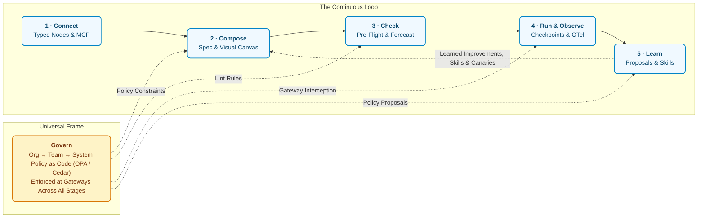
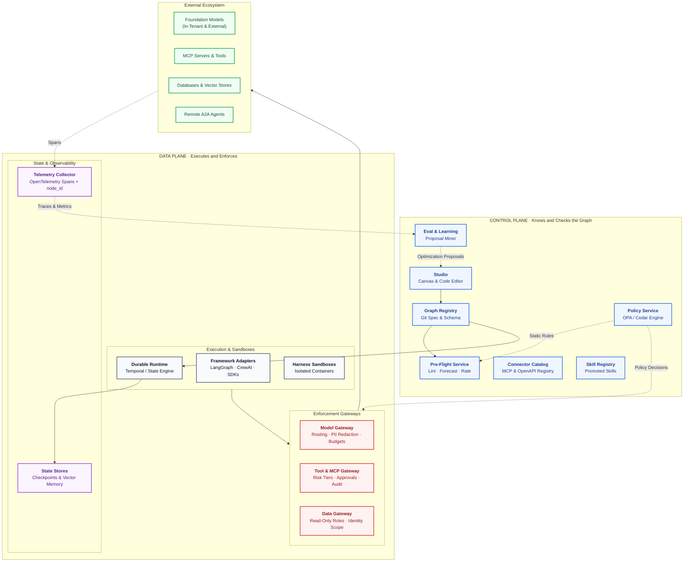

# Trellis: A Vendor-Neutral Workbench for Enterprise Agentic Systems

[](#)
[](#)
[](#)
[](https://general-agentic-system-platform.afnaankhan11.workers.dev)
[](PLAN.md)

> **Know what an agent system will do, cost, and be allowed to touch before it runs.**

Trellis is a shared workbench and control plane for enterprise agentic systems. Teams connect their tools and data sources once, compose multi-agent workflows and coding harnesses on a canvas or in code, run **pre-flight checks** before execution, execute durably under unified governance, and improve systems from real execution telemetry.

Trellis sits **above** the frameworks teams already use (LangGraph, Microsoft Agent Framework, CrewAI, AutoGen, Claude Code, Codex). It connects and governs them without forcing runtime rewrites.

---

## 🌟 Interactive Live Demo

The full interactive prototype is deployed live on Cloudflare's global edge network:

🌐 **Live Application:** [**https://general-agentic-system-platform.afnaankhan11.workers.dev**](https://general-agentic-system-platform.afnaankhan11.workers.dev)

Direct links to interactive modules:
- [**Studio Canvas**](https://general-agentic-system-platform.afnaankhan11.workers.dev/canvas.html#triage): Visual DAG editor with real-time linting, p50/p95 forecasting, and one-click graph fixes.
- [**Pre-Flight Checker**](https://general-agentic-system-platform.afnaankhan11.workers.dev/check.html): 2,000-run Monte Carlo cost & latency simulator and static rule catalog.
- [**Trace Replay & Checkpoints**](https://general-agentic-system-platform.afnaankhan11.workers.dev/run.html): Step-through durable trace player with crash recovery and multi-goal budget allocator.
- [**Policy Simulator**](https://general-agentic-system-platform.afnaankhan11.workers.dev/govern.html): Multi-layer OPA/Cedar rule evaluator with write-tier enforcement and audit log.
- [**Learning & Skill Mining**](https://general-agentic-system-platform.afnaankhan11.workers.dev/learn.html): Trace-derived proposal inbox (canary rollouts, model swaps) and skill registry.
- [**Workshop**](https://general-agentic-system-platform.afnaankhan11.workers.dev/workshop.html): Ephemeral sandbox test ladder (fakes, recorded replay, real sandboxes) and framework exporter.
- [**Architecture Blueprint**](https://general-agentic-system-platform.afnaankhan11.workers.dev/blueprint.html): Interactive component plane visualizer and implementation Gantt chart.

### Running Locally
```bash
# Start any local static server:
python -m http.server 8090
# Open http://localhost:8090/index.html in your browser
```

---

## 1. Vision & Core Problem

### The Missing Layer Around Agents

| What Teams Live With Today | Typical Symptom | How Trellis Solves It |
|---|---|---|
| **Every team rebuilds plumbing** (connectors, retries, approvals, secrets, tracing) | 4 different approval implementations, none audited consistently | **Connect Once:** Typed node contracts generated from MCP annotations & OpenAPI |
| **Cost and latency only appear in production** | A $0.04 query explodes to $1.90 when a loop iterates 14 times | **Pre-Flight Forecaster:** Monte Carlo p50/p95 cost and latency projections before runtime |
| **Governance is fragmented across teams** | No unified answer to "what databases can our agents write to?" | **Gateway Enforcement:** Centralized Model, Tool, and Data gateways enforcing policy-as-code |
| **Nothing learns from production runs** | Thumbs-down feedback is logged and ignored; team fixes remain siloed | **Closed-Loop Learning:** Run traces automatically mined into reviewable proposals and cross-team skills |

None of these challenges stem from underlying LLM quality; they stem from the **missing operational layer around agentic architectures**.

---

## 2. The Agentic Lifecycle

Trellis structures the development and operation of agent systems into a continuous, self-improving loop:



### Stage Summary

1. **Connect:** Each integration (database, vector store, message queue, MCP server, model, coding harness) becomes a **typed node** with an explicit contract: capabilities, data classes, network boundaries, cost, latency, authentication, and defaults.
2. **Compose:** Systems are authored on a visual canvas or directly in code. Both edit the same declarative, version-controlled **Graph Specification** (`trellis.dev/v1alpha1`). Agents, coding harnesses, routers, loops, approval gates, and vector memories are all first-class nodes.
3. **Check:** **Design-time pre-flight verification.** Lints the topology, forecasts cost/latency distributions at p50 and p95 via Monte Carlo simulation, rates graph quality (0–100), and offers one-click automated remediations.
4. **Run & Observe:** Durable execution with checkpoints at node boundaries. Runs survive infrastructure crashes, can wait hours for human approval, and support replay and forking. Spans follow OpenTelemetry GenAI semantic conventions tagged with `trellis.node_id`.
5. **Learn:** Telemetry, reviewer corrections, eval outcomes, and production traces are mined into actionable **proposals** (model swaps, prompt compaction, new routes, canary rollouts) and reusable **skills**.
6. **Govern:** Multi-layered policy (Org → Team → System → Node) evaluated at design time in pre-flight and enforced at runtime by Model, Tool/MCP, and Data Gateways.

---

## 3. System Architecture

Trellis separates concerns cleanly between a **Control Plane** that understands the graph topology and a **Data Plane** that enforces policy and executes runs:



### Component Breakdown

| Component | Plane | Build / Adopt | Candidate Technology | Phase |
|---|---|---|---|---|
| **Studio** | Control | Build | React + React Flow (xyflow) canvas, Monaco editor for specs | Phase 3 |
| **Graph Registry** | Control | Build | Git repository (GitHub / GitLab) + JSON Schema validator | Phase 0 |
| **Pre-Flight Service** | Control | **Build** | Pure AST visitor + Monte Carlo forecaster calibrated from traces | Phase 1 |
| **Policy Service** | Control | Adopt + Rules | Open Policy Agent (OPA/Rego) or AWS Cedar | Phase 2 |
| **Eval & Learning** | Control | Build on Adopted | Evaluation scoring harnesses + proposal mining algorithm | Phase 4 |
| **Skill Registry** | Control | Build | Git-backed versioned markdown/code skill files with index | Phase 4 |
| **Connector Catalog** | Control | Build | Automated contracts generated from MCP annotations & OpenAPI | Phase 0 |
| **Durable Runtime** | Data | Adopt | Temporal or lightweight durable state machine | Phase 3 |
| **Framework Adapters** | Data | Build | Standard adapters: Agent Framework, LangGraph, CrewAI | Phase 0 (import), 3 (run) |
| **Harness Sandbox Pool** | Data | Adopt + Config | Ephemeral containers (Kubernetes Jobs / Container Apps) with network egress filters | Phase 3 |
| **Model Gateway** | Data | Adopt + Extend | LiteLLM proxy / AI Gateway + Trellis policy hooks & PII scrubbers | Phase 2 |
| **Tool & MCP Gateway** | Data | Build | Authenticating MCP proxy enforcing risk tiers and approvals | Phase 2 |
| **Data Gateway** | Data | Build on Drivers | Database connection proxy enforcing read-only roles & OBO identity | Phase 2 |
| **State Stores** | Data | Adopt | PostgreSQL for checkpoints; pgvector for episodic/semantic memory | Phase 3 |
| **Telemetry** | Data | Adopt | OpenTelemetry collector routing to Langfuse / Arize Phoenix / App Insights | Phase 2 |

---

## 4. Declarative Graph Specification (`trellis.dev/v1alpha1`)

Below is an illustrative specification representing a **Customer Support Triage System**:

```yaml
apiVersion: trellis.dev/v1alpha1
kind: AgentSystem
metadata:
  name: support-triage
  team: customer-support
spec:
  goals:
    - Resolve or route inbound tickets within 2 minutes
  runtime:
    checkpoint: every            # every | approvals | off
    budget_per_run_usd: 0.25
  evals:
    golden_set: "datasets/triage-golden-v2.jsonl"
  policy:
    inherit: [org/default, team/customer-support]
  nodes:
    - id: t1
      type: trigger
      name: Inbound Ticket
      source: SupportHelpdesk
      untrusted: true
      pii: true

    - id: t2
      type: guardrail
      name: Redact PII
      strategy: regex_and_named_entity_scrub

    - id: t3
      type: agent
      name: Classify Intent
      model: small-tenant-fast
      task: classify
      tin: 900
      tout: 30

    - id: t10
      type: agent
      name: Assess Refund Eligibility
      model: medium-in-tenant
      tin: 1800
      tout: 200

    - id: t11
      type: approval
      name: Manager Approval Gate
      required_when: "amount_usd > 100"
      timeout_hours: 24
      fallback: escalate_to_lead

    - id: t12
      type: tool
      name: Issue Refund API
      connector: payment-gateway
      write: true
      tier: 3

  edges:
    - { from: t1, to: t2 }
    - { from: t2, to: t3 }
    - { from: t3, to: t10, when: "intent == 'refund'", share: 0.23 }
    - { from: t10, to: t11, when: "eligible == true" }
    - { from: t11, to: t12, when: "approved == true" }
```

### Connector Contract Model

Every integrated tool or service declares a typed contract:

```yaml
connector: payment-gateway
kind: tool
owner: team/finance-platform
capabilities:
  - read: get_transaction_history
  - write: issue_refund
    risk_tier: 3                  # Tier 1: Reversible · Tier 2: User-visible · Tier 3: Financial/Destructive
emits: [internal, pii]            # Data classifications flowing along outbound edges
boundary: tenant                  # tenant | processor | internet | laptop
cost: { per_call_usd: 0.0004 }
latency_ms: { p50: 380, p95: 1100 }
auth: managed_identity
defaults:
  timeout_s: 10
  retries: { max: 2, on: [429, 503] }
  approval: { required_when: "risk_tier >= 3" }
  rate_limit: 60/min
```

---

## 5. Design-Time Pre-Flight Check Engine

Pre-flight acts as a **"compiler / type-checker for multi-agent systems"**. It flags structural hazards, security boundary violations, unbounded loops, and cost blowouts before deployment.

### Starter Rule Catalog

| Rule ID | Severity | Category | Condition Detected | Suggested Remediation |
|---|---|---|---|---|
| **T-01** | `Error` | Topology | Cyclic loop with no terminating exit node | Insert exit condition: success check + max iterations + run budget |
| **T-02** | `Error` | Topology | Exit test references state field never produced | Correct test reference to an active upstream node |
| **T-03** | `Warning` | Topology | Fan-out over a list with no explicit concurrency cap | Set batch size limit (e.g., `max_concurrency: 5`) |
| **T-04** | `Warning` | Topology | Loop exit has success test but lacks iteration ceiling | Add `max_iterations: 10` and monetary budget cap |
| **S-01** | `Error` | Security | Tier-3 destructive/financial write without approval gate | Insert human approval node before tool execution |
| **S-02** | `Error` | Security | Coding harness configured outside sandbox / open egress | Enforce container sandbox with egress allowlist |
| **S-03** | `Warning` | Security | Untrusted inbound text reaches an acting agent unscreened | Insert prompt injection filter node |
| **S-04** | `Notice` | Security | Agent granted high-privilege tools unused across past 200 runs | Strip unused tools to enforce principle of least privilege |
| **D-01** | `Error` | Data | PII/Confidential data reaches external processor model | Insert redaction node or migrate to in-tenant model |
| **D-02** | `Warning` | Data | PII written into persistent memory without TTL policy | Configure data retention policy and deletion lifecycle |
| **C-01** | `Notice` | Cost | Ultra-large model assigned to trivial classification task | Downscale to fast, cost-efficient model; run eval set |
| **C-02** | `Warning` | Cost | Unbounded context accumulation across loop passes | Insert context compaction / summarization step |
| **R-01** | `Warning` | Reliability | Human approval node lacks timeout or escalation fallback | Define timeout duration and automatic escalation path |
| **R-02** | `Warning` | Reliability | External network call lacks retry or circuit breaker policy | Attach connector default timeout and retry specs |
| **R-03** | `Error` | Reliability | Checkpoint disabled on graph containing human approval gate | Enable checkpointing at every approval boundary |

### Example CLI Output in CI/CD

```text
$ trellis preflight systems/support-triage.trellis.yaml

✗ S-01  error    "Issue Refund API" writes at tier 3 with no human approval    [node: t12]
✗ D-01  error    PII from "Inbound Ticket" reaches external model unscreened   [node: t10]
• C-01  notice   "Classify Intent" uses large model for boolean classification [node: t3]

Forecast:
  Cost per Run:    p50 $0.018  ·  p95 $0.029
  Latency per Run: p50 11.2 s  ·  p95 16.4 s
Graph Quality:     64 / 100
Gate Status:       FAIL (2 blocking errors must be remediated)
```

---

## 6. The Three Canonical Topologies

The workbench includes three representative enterprise architectures:

1. **Customer Support Triage (Router Workflow):**
   - *Shape:* Linear routing with redaction, intent classification, knowledge retrieval, and conditional human escalation for financial refunds.
   - *Seeded issues in demo:* Missing tier-3 approval, PII leakage to external models.
2. **Multi-Agent PR Review (Parallel Coding Harnesses):**
   - *Shape:* Parallel autonomous agents (correctness checking, test generation, security scanning) coordinated into a consolidated synthesis report.
   - *Seeded issues in demo:* Untrusted git diff reaching coding harness outside sandbox; missing evaluation golden set.
3. **Incident Investigator (Goal-Based SCC Loop):**
   - *Shape:* Continuous loop querying diagnostic telemetry and database health, forming hypotheses, scoring evidence, and terminating on root cause confirmation or budget depletion.
   - *Seeded issues in demo:* Unbounded iteration loop (p95 latency infinite); context window exploding on successive iterations.

---

## 7. The Workshop: Sandbox, Test & Export

Teams retain their existing codebases and deployments. The **Workshop** provides an ephemeral sandbox to evolve systems safely:

```
Branch System → Canvas / Spec Edit → Pre-Flight Gate → Test Ladder → Framework PR
```

### The 5-Rung Test Ladder

| Rung | Execution Mode | What Is Real | Use Case |
|---|---|---|---|
| **1 · Recorded Replay** | Instantaneous | Models; tool outputs replayed from past telemetry traces | Fast iteration on prompt edits |
| **2 · Contract Fakes** | Seconds | Models; tools synthesized from schemas including error states | Validating retry loops & fault handlers |
| **3 · Real Sandboxes** | Minutes (~$2) | Models + real sandbox systems (test payment modes, sandbox DBs) | **Merge gate** for pull requests |
| **4 · Shadow Traffic** | Hours | Live production inputs; destructive writes silenced | Validating accuracy on production distributions |
| **5 · Canary Rollout** | Continuous | Live traffic split (10% → 100%) with automated rollback | Safe production promotion |

### Native Framework Exporters

Trellis generates native code in each framework's standard format rather than imposing an abstracted runtime wrapper:
- **Microsoft Agent Framework:** Declarative YAML workflows + custom node Python stubs.
- **CrewAI:** Standard `agents.yaml` and `tasks.yaml` configuration bundles.
- **LangGraph:** Python module instantiating typed `StateGraph` definitions.
- **Trellis Embedded SDK:** Lightweight runtime interpreting the raw graph specification directly.

---

## 8. Implementation Roadmap & Milestones

Trellis is built in five phased increments, with each phase delivering independently verifiable value to engineering teams:

- **Phase 0 (Weeks 1–3):** Graph Spec v1alpha1, JSON Schema, and Agent Framework & LangGraph importers.
- **Phase 1 (Weeks 4–9):** Pre-flight engine as CLI and CI/CD gate with 10 core rules and Monte Carlo forecaster.
- **Phase 2 (Weeks 10–17):** Model, Tool/MCP, and Data Gateways; Policy-as-Code service; OpenTelemetry trace ingestion.
- **Phase 3 (Weeks 18–27):** Studio Canvas UI; Durable native runtime; Slack/Teams approvals; Workshop sandboxes.
- **Phase 4 (Week 28+):** Closed-loop learning; Proposal inbox; Cross-team skill mining and registry.

👉 **For the complete engineering roadmap, pilot execution plans, architectural decision records, and risk assessments, read [PLAN.md](PLAN.md).**

---

## 9. Deploying to Cloudflare Pages

The interactive demo is built using pure modern Web standards (HTML5, Vanilla CSS, ES6 JavaScript) with **zero compilation or build steps**. It deploys to Cloudflare Pages in seconds:

### Option A: Connected via GitHub (Continuous Deployment)
1. Push this repository to GitHub.
2. In the **Cloudflare Dashboard**, navigate to **Workers & Pages** → **Create application** → **Pages** → **Connect to Git**.
3. Select this repository.
4. Set the build configuration:
   - **Framework preset:** `None`
   - **Build command:** *(leave empty)*
   - **Build output directory:** `/` (or leave blank for root directory)
5. Click **Save and Deploy**. Cloudflare will host the live interactive demo across its global edge network.

### Option B: Deploy via Wrangler CLI
```bash
# Install wrangler if needed
npm install -g wrangler

# Deploy from repository root
wrangler pages deploy . --project-name=trellis-agent-workbench
```

---

## 10. Local Development & Contribution

```bash
# 1. Clone the repository
git clone https://github.com/EnterAfnaan/General-Agentic-System-Platform.git
cd General-Agentic-System-Platform

# 2. Start any local static server
npx serve .
# or:
python -m http.server 8090

# 3. Open http://localhost:8090/index.html in your browser
```

### Repository Structure

```text
├── README.md           # Executive & technical platform documentation
├── PLAN.md             # Detailed 5-phase implementation plan, ADRs & risks
├── index.html          # Interactive Overview & lifecycle explorer
├── canvas.html         # Interactive Studio Canvas & live lint/forecast workbench
├── check.html          # Pre-flight rule catalog & 2,000-run Monte Carlo simulator
├── connect.html        # Interactive Connector & MCP catalog with contract inspector
├── run.html            # Trace replay player, crash recovery & budget allocator
├── govern.html         # Policy-as-code simulator & audit log explorer
├── learn.html          # Proposal inbox & skill mining configuration builder
├── workshop.html       # Ephemeral sandbox test ladder & framework exporter
├── blueprint.html      # Interactive system architecture visualizer & Gantt chart
├── styles.css          # Design system tokens, dark/light themes & layout components
└── shared.js           # Navigation rail, drawer/modal systems & state helpers
```

---

## 11. License

Licensed under the [Apache License, Version 2.0](LICENSE).
